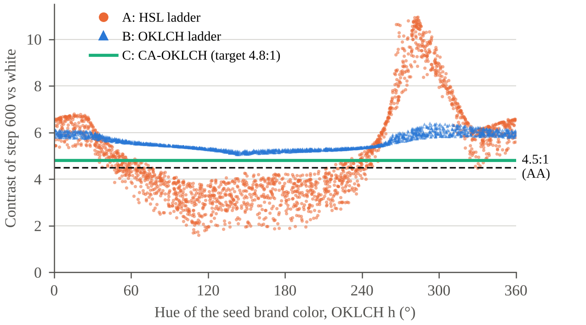

# Accessible tonal scales from a brand color (OKLCH)

Code and data for the conference theses:

> Shevchenko S. V. *Generating accessible tonal scales from a brand color in the OKLCH color space for automated design systems*. XVIII All-Ukrainian Scientific and Practical Conference "Actual Problems of Computer Sciences" (APKN-2026), Khmelnytskyi National University, 16–17 November 2026.

The experiment expands 2000 random brand colors into ten-step tonal scales (50–900) with three methods and checks whether a design system built on each scale meets WCAG 2.2 contrast requirements.

| Method | Idea |
|---|---|
| A: HSL | Keep the seed's HSL hue and saturation; fixed HSL lightness ladder 0.97…0.18 |
| B: OKLCH | Keep the seed's OKLCH hue and relative chroma; uniform OKLCH lightness ladder 0.97…0.30 |
| C: CA-OKLCH (proposed) | For each step, solve OKLCH lightness by bisection so the color hits a target WCAG contrast against white |

The accessibility contract checks five pairs: white text on step 600 (≥ 4.5:1), text 700 on white (≥ 4.5:1), text 700 on surface 50 (≥ 4.5:1), UI element 500 on white (≥ 3:1), and dark-theme text 100 on surface 800 (≥ 4.5:1).

## Results

| Method | Full contract pass, % | Contrast of 600 vs white | Unevenness (CV) | Mean hue drift, ° |
|---|---|---|---|---|
| A: HSL | 51.3 | 1.60–10.95 | 0.30 | 2.2 |
| B: OKLCH | 100 | 5.06–6.40 | 0.09 | 0 |
| C: CA-OKLCH | 100 | 4.80 | 0.25 | 0 |



## How to run

Requires Python 3.9+.

```bash
pip install -r requirements.txt
python experiment.py   # about 4 minutes; writes results/results.json and the .npy arrays
python figure.py       # writes results/fig1.png (300 dpi)
```

The random generator seed is fixed (2026), so repeated runs give identical numbers.

## Files

- `experiment.py` — color conversions (sRGB, OKLab/OKLCH, HSL), the three scale generators, the contract check and the metrics
- `figure.py` — Figure 1 of the theses
- `results/results.json` — all metrics, including per-pair pass rates and contrast ranges for every step

## License

MIT
